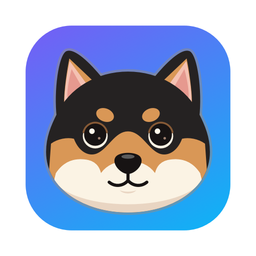
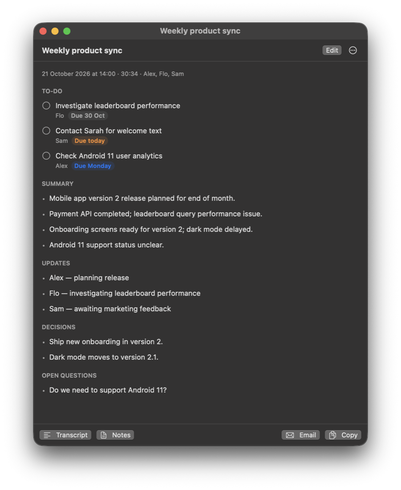

<p align="center"></p>

<h1 align="center">MeetScribe</h1>

<p align="center"><b>Meeting notes that stay on your Mac.</b><br>
Records your Teams, Zoom or Meet calls, works out who said what, and writes a summary, the decisions
and a to-do list — with AI that runs entirely on your Mac. Free, open source, no account.</p>

<p align="center">
  <a href="https://github.com/Gbally/MeetScribe-releases/releases/latest"><b>Download for Mac</b></a> ·
  <a href="https://gbally.github.io/MeetScribe-releases/">Website</a> ·
  <a href="PRIVACY.md">Privacy</a> ·
  <a href="mac/INSTALL.txt">Install guide</a>
</p>

<p align="center"></p>

## Why

Meeting assistants usually send your calls to a cloud service. MeetScribe doesn't: speech
recognition (Whisper), speaker separation and the notes (Qwen) all run on your Mac's Apple silicon.
Your recordings, transcripts and notes are plain files in a folder you choose.

## Features

- **Records any call** — Teams, Zoom, Meet, Webex: your microphone and the meeting audio as two
  tracks, from the menu bar, a keyboard shortcut (⌃⌥R by default), or automatically when a call
  starts.
- **Knows who spoke** — your voice is labelled with your name; the other voices are separated,
  and once you name a colleague they're recognised in later meetings.
- **Notes you can use** — summary, decisions, open questions and to-dos with owners and real due
  dates ("next Friday" → a date), shaped by the meeting type (1:1, stand-up, client call…).
  To-dos and decisions are looked for twice and each one is checked against what was really said,
  so nothing is made up and little is missed.
- **Calendar:** the current Outlook/Exchange event (via macOS Calendar) names the meeting and
  gives the AI the attendees; "Email" opens an Outlook draft to them with the notes.
- **My to-dos:** every action item assigned to you, across all meetings, in one list.
- **Known voices:** name a speaker once (⋯ → Name the speakers) and they're recognised in later
  meetings (voiceprints in `voices.json`, never uploaded).
- **Call reminder:** when Teams/Zoom/a browser opens the microphone, a notification offers
  **Record**; when the calendar meeting is over, it offers **Stop & create notes**.
- **Languages:** tick the languages your meetings use (e.g. English + French) and switches are
  detected every few seconds; notes are written in the meeting's main language (or a fixed one).
- **Learns your jargon:** names and terms that came back in earlier meetings of the same series
  (calendar title or the same people) are given to the transcription, so "Godot" or "PS5" stay
  spelled right; your own vocabulary (Settings) comes first.
- **Reminders:** send your to-dos to Apple Reminders.
- **Import a transcript** (⋯ → Import a transcript…): a `.vtt`, `.srt`, `.sbv`, `.docx`, `.txt` or `.md`
  saved by Teams, Zoom, Google Meet, Granola, Otter… gets the same notes as a recording, with
  the speakers' names from the file.
- **Send to other apps:** a meeting's ⋯ → Send to… adds the notes to Apple Notes, or the to-dos
  to Things; Settings → Notes → Export copies every meeting's notes as Markdown into a folder
  (an Obsidian vault, Logseq…), with the date, participants and a #meeting tag.
- **Briefs:** 5 min before a calendar meeting that happened before (same series, title or
  people), a notification shows what's still open from last time.
- **Due dates:** "Friday", "next week", "30 Oct", "fin du mois"… become real dates; "My to-dos" is
  sorted by them and you get a reminder the day before.
- **Ask your meetings:** search box on the main window; ↩ asks the local AI, which answers from
  your notes/transcripts with sources.
- **Automatic mode** (optional): starts recording when a call app opens the mic, stops when it
  releases it (per-process CoreAudio, macOS 14+).
- **Meeting types:** General, 1:1, Stand-up, Client call, Interview, Workshop — each with its
  own sections; "Regenerate as…" to switch.
- **Shortcut:** start/stop from anywhere (default ⌃⌥R, changeable in Settings).
- **Edit:** rename a meeting, fix/add/delete to-dos (notes.md is rebuilt with `meetscribe render`).
- **Privacy:** audio (and voice samples) deleted after 7 days by default; notes are kept.
- **Many languages** — 99 spoken languages, even switching mid-meeting; the app itself is in
  English, French, Spanish, Portuguese, Japanese and Chinese.
- **Updates itself**, picks AI models that fit your Mac's memory (and says so when one runs out of
  it, with a smaller one to choose), and removes itself cleanly
  (Settings → Privacy and storage → Remove MeetScribe).

## Install

Requirements: a Mac with Apple silicon (M1 or newer), macOS 13 or later, 8 GB memory or more
(16 GB recommended), ~8 GB free disk space.

1. Download the `.dmg` from the [latest release](https://github.com/Gbally/MeetScribe-releases/releases/latest)
   and drag MeetScribe into Applications.
2. Open it. The first time, macOS may say it can't verify the developer (the app isn't notarized
   yet): System Settings → Privacy & Security → **Open Anyway**.
3. A welcome window takes you through your name, languages, permissions and the AI models
   download (4–6 GB, once).

Details in [INSTALL.txt](mac/INSTALL.txt). Always tell the other participants that you're
recording, and follow your company's rules.

## Privacy

Audio, transcripts and notes never leave your Mac, and there are no analytics or tracking of
any kind. The only network traffic is the update check, the one-time engine and model
downloads, and email drafts if you choose a web mail — see [PRIVACY.md](PRIVACY.md).

## How it works

```
Meeting audio (ScreenCaptureKit) ─┐                 ┌─ Whisper large-v3-turbo (MLX, GPU)
                                  ├─ 2 tracks ──────┤
Your microphone (AVAudioEngine)   ┘                 └─ speaker separation (sherpa-onnx, CPU)
                                                            │
                       transcript.md ◄── merge + echo removal ┘
                       notes.md      ◄── Qwen3 (MLX): summary, decisions, to-dos
```

Your mic and the meeting audio are recorded **separately**, so everything you say is labelled with
your name, and speaker separation only has to tell the remote people apart. Without headphones,
the remote voices picked up by your mic are detected and removed.

The app is a SwiftUI menu bar app (`mac/`); the processing is a Python engine (`src/meetscribe/`)
that the app installs on first launch into `~/Library/Application Support/MeetScribe` with the
bundled [uv](https://github.com/astral-sh/uv).

## Build from source

Needs the Xcode command line tools (`xcode-select --install`) and [uv](https://github.com/astral-sh/uv).

```sh
./scripts/make_signing_identity.sh   # once: a stable self-signed identity (keeps permissions across builds)
./scripts/build_app.sh               # → build/MeetScribe.app + dist/MeetScribe-<version>.dmg
```

**Permissions across updates:** macOS remembers permissions per code signature. Run
`./scripts/make_signing_identity.sh` once: it creates a fixed self-signed identity in
`signing/` (its own keychain file, gitignored — **back it up**), and every build is signed with it,
so permissions survive updates. Without it, builds are ad-hoc signed and every update re-asks.

**Signing:** without a Developer ID the app is self-signed, so on another Mac macOS blocks the first
open (System Settings → Privacy & Security → Open Anyway). For a warning-free install, sign with
an Apple Developer ID and notarize — or have IT deploy it via MDM.

**Moving to a Developer ID (once).** Installed apps only accept an update signed like themselves,
so the switch takes two releases:

1. Join the Apple Developer Program, create a *Developer ID Application* certificate (it lands in
   your login keychain) and note your Team ID (10 characters). Store notarization credentials:
   `xcrun notarytool store-credentials meetscribe-notary --apple-id … --team-id TEAMID`.
2. **Transition release**, still self-signed: `DEVELOPER_TEAM=TEAMID ./scripts/release.sh "…"`.
   Apps that install it also accept updates signed by that team.
3. A few days later, every release: `SIGN_ID="Developer ID Application: Name (TEAMID)"
   DEVELOPER_TEAM=TEAMID ./scripts/release.sh "…"` — signs with the hardened runtime, notarizes
   and staples the DMG (`scripts/notarize.sh`). macOS asks for the microphone / audio permissions
   once more after that first notarized update (the signature changed).

### Releasing (maintainer)

Bump `version` in `pyproject.toml`, commit, then:

```sh
./scripts/release.sh "What's new"            # prepare: builds and checks, nothing is sent
./scripts/release.sh --publish               # GitHub release with the DMG, then latest.json
./scripts/publish_catalog.sh                 # new tested models only (models.json), no new version
```

Installed apps read `latest.json` and `models.json` at the root of this repository — keep them
there. The website is `docs/` (GitHub Pages).

## Command line (for development)

### Setup (once)

```sh
./setup.sh --models     # Python env, speaker models, recorder, Whisper + LLM (~6 GB)
cp config.example.toml config.toml   # then set `me = "Your Name"`
```

Handy alias (add to `~/.zshrc`):
`alias meetscribe=/path/to/MeetScribe/.venv/bin/meetscribe`

**Permissions:** the first `meetscribe record` needs your terminal app (Terminal / iTerm)
allowed in System Settings → Privacy & Security → **Microphone** and **Screen & System
Audio Recording**. Restart the terminal after granting.

### Use

```sh
meetscribe record --title "Weekly sync"            # Ctrl+C when the meeting ends
meetscribe record --app "Microsoft Teams"           # only Teams' audio (no notifications/music)
meetscribe record --room                            # in-person meeting: everyone on your mic
meetscribe record --speakers 3                      # if you know how many remote people talk

meetscribe process ~/Downloads/recording.m4a        # any existing audio file (Teams export, phone…)
meetscribe rename <folder> "Speaker 1=Alice" "Speaker 2=Bob"   # name speakers, redo the notes
meetscribe summarize <folder>                       # rewrite notes (e.g. after changing the model)
```

Each meeting gets a folder in `~/Documents/MeetingNotes/` with `notes.md`,
`transcript.md`, `transcript.json` and the raw audio (`mic.caf`, `system.caf`).

### Tips

- **Headphones** give the cleanest result (no echo to remove).
- Put names and jargon in `vocabulary` in `config.toml` so Whisper spells them right.
- Meetings are mostly English; set `language = "en"` to stop Whisper from guessing
  wrong on short French bits, or leave it empty to auto-detect.
- Better notes: `llm_model = "mlx-community/Qwen3.5-9B-4bit"` (≈6 GB; fine on 16 GB if
  you're not running much else). Or point `llm_backend = "openai"` at Ollama / LM Studio.
- Too many / too few speakers? Pass `--speakers N`, or tune `diarization_threshold`.

## Translations

The app is in English, French, Spanish, Portuguese, Japanese and Chinese (Simplified). It follows the
Mac's language (anything else → English); Settings → General → Language forces one.

- Texts live in `mac/Localization/<lang>.json` (English text → translation). Placeholders are
  `%@` (or `%1$@`, `%2$@` to reorder them).
- After changing UI texts: `python3 scripts/i18n.py extract` adds new texts to every language file
  (empty = not translated yet, English is shown) and lists anything left to translate.
- **Add a language:** copy `en.json` to `<code>.json`, translate the values, add the code to
  `AppLanguage.supported` (`mac/Shared/Localization.swift`) and to `LANGS` in `scripts/i18n.py`,
  and to `CFBundleLocalizations` in `scripts/build_app.sh`.
- Model descriptions are translated in `catalog/models.json` (`"descriptions": {"fr": …}`).
- Engine progress messages are translatable too (`progress.step("…%@…", value)`).

## Layout

- `mac/Shared/AudioCapture.swift` — mic + system audio capture (shared)
- `mac/App/` — the menu bar app (SwiftUI); `mac/CLI/` — `bin/meeting-recorder`
- `scripts/` — `build_app.sh` (app + DMG), `build_recorder.sh`, `make_icon.swift`
- `src/meetscribe/` — `audio` (decode), `transcribe` (Whisper), `diarize` (speakers),
  `transcript` (merge, echo removal, output), `summarize` (LLM notes), `cli`

## Translations

The app follows the Mac's language (anything not translated → English); Settings → General →
Language forces one.

- Texts live in `mac/Localization/<lang>.json` (English text → translation). Placeholders are
  `%@` (or `%1$@`, `%2$@` to reorder them).
- After changing UI texts: `python3 scripts/i18n.py extract` adds new texts to every language file
  (empty = not translated yet) and lists what's left.
- **Add a language:** copy `en.json` to `<code>.json`, translate the values, add the code to
  `AppLanguage.supported` (`mac/Shared/Localization.swift`), `LANGS` in `scripts/i18n.py` and
  `CFBundleLocalizations` in `scripts/build_app.sh`. Native-speaker reviews are very welcome.

## Repository layout

- `mac/App/` — the menu bar app (SwiftUI); `mac/Shared/` — audio capture; `mac/CLI/` — command-line recorder
- `src/meetscribe/` — the engine: `transcribe` (Whisper), `diarize` (speakers), `transcript` (merge,
  echo removal), `summarize` (notes), `ask`, `dates`, `cli`
- `scripts/` — build, release, translations; `catalog/models.json` — tested models
- `docs/` — the website; `eval/` — model comparison on sample transcripts
- `latest.json`, `models.json` — read by installed apps for updates

## Contributing

Bug reports and ideas: [open an issue](https://github.com/Gbally/MeetScribe-releases/issues).
Pull requests welcome — please keep `python3 scripts/i18n.py extract` clean.

## License

[MIT](LICENSE) © 2026 Gbally. MeetScribe builds on Whisper, Qwen, pyannote, NVIDIA TitaNet, MLX,
sherpa-onnx and more — see [THIRD_PARTY_NOTICES.md](THIRD_PARTY_NOTICES.md).
